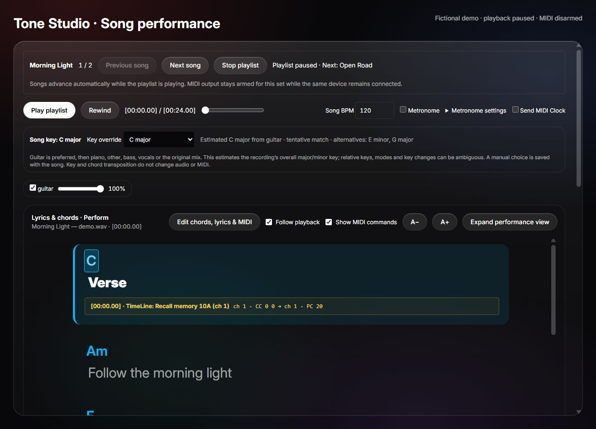
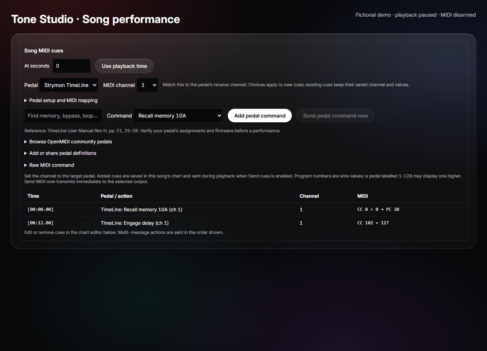
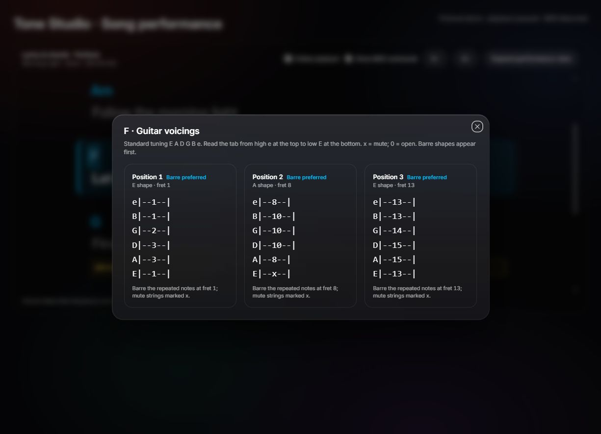

# Performance and GP-150 / GP-180 support

## GP-150 and GP-180 support

GP-150 and GP-180 share the editor protocol, preset format and performance MIDI command set. GP-150 has two footswitches and a built-in expression pedal; GP-180 has three footswitches. Both are supported over USB and for Bluetooth performance MIDI. Separate model identities and footswitch layouts are preserved. The command builder offers both models, and setup presets cover both. Existing GP-180 saved settings and cues remain compatible. Physical validation in this project used GP-180; GP-150 has not been hardware-tested in this session.

## Use

Saved songs and ordered playlists are available in the desktop app under **Song → Songs & playlists**. Choose **Play playlist** for automatic playback of the whole set, or **Play from here** on a playlist entry. Performance shows set progress, next song and skip/stop controls. See [the song library guide](SONG-LIBRARY.md) for offline storage and live set controls.

Open **Song → Performance**. Load audio through Stems first; splitting is optional for playback. After a split, Performance plays the stems together and offers individual mute switches and volume sliders. The unsplit song has its own volume slider too. The existing Stems mixer retains its level, solo and WAV-export controls.

**Lyrics & chords · Perform** combines the lyric track and chord changes in one reading view. Playback highlights the current line and chord and scrolls within the reader, including after seeking backward. Chart lyrics and chords take priority over automatic drafts; chord-only charts can accompany the separate transcribed lyrics. Chords appear above the lyric interval containing their timestamp, rather than claiming exact word alignment. Untimed text supports manual reading. Toggle **Follow playback** to scroll freely, use **A− / A+** for text size, or **Expand performance view** for a larger view with transport controls (Escape closes it). The original tracks, chart editor, and chord-source controls remain under **Separate lyrics and chart editors**.

Click a chord in the reader, chart preview, or stem estimates to open its guitar tabs. Standard tuning is assumed, with high e at the top and low E at the bottom; `x` means muted and `0` means open. Several positions are offered with barre shapes first, preferring closed shapes over open-string shapes. Tabs follow the displayed transposition. Common major, minor, seventh, suspended, diminished, augmented, power and slash chords are supported; unsupported spellings show an explicit message. Shapes are checked against the chord tones and requested bass. Escape closes the overlay without closing the expanded reader or stopping playback.

## Pedal command library

**Song MIDI cues** now offers named presets for TimeLine, RC-10R, IR-200, SY-200, GP-150 and GP-180. Choose the pedal and its receive channel, then select a memory or function. Bank-select sequences are generated where needed. BOSS assignable controls require the matching CC setting from the pedal. Cues retain readable labels in the chart and scheduled-cue list. **Raw MIDI command** remains available. See [pedal profiles and custom JSON import/export](MIDI-PEDALS.md).

## Recognition implementation and limits

The existing AI pipeline separates stems with Demucs and transcribes the vocals with local quantized Whisper base through Transformers.js. Choose **Lyrics language** before regenerating to supply a known language instead of relying on automatic detection. Language hints are supported by the [Transformers.js speech recognition pipeline](https://huggingface.co/docs/transformers.js/v3.0.0/en/api/pipelines). The setting travels with the saved song options. Near-identical transcript chunks less than half a second apart are deduplicated; later repeated verses are retained.

Chord recognition is FFT/chroma matching, not a learned chord model, and still estimates major/minor triads only. It now analyses the louder stereo channel to avoid opposite-phase cancellation and removes isolated non-silent label changes between matching neighbours. Silence and sustained changes remain. These behaviours have synthetic regression tests; no real-song accuracy gain has been measured. Existing separation quality/source controls can help provide cleaner inputs, but the Whisper speech model cannot replace a chord recognizer. Extended-chord recognition and a larger lyrics model need a separate implementation and evaluation on labelled recordings; the tab vocabulary does not expand the recognizer's vocabulary.

Paste or import TXT, LRC or bracket-chord text. For unsaved audio, charts, lyrics and BPM are stored locally under the filename, sample rate and frame count; identical keys share these settings. Saving to the song library assigns a unique ID and copies audio, stems and performance settings. Export charts separately or back up the complete song library to keep another copy. Transposition affects chord symbols, including slash bass notes, without pitch-shifting audio. Bold (`**text**`) and italic (`*text*`) formatting are supported; full ChordPro directives are not.

Use timestamps on every displayed line for playback-following lyrics:

```text
[00:00.00] [C]**Verse**
[00:12.50] [Am]Words here {midi:pc 1 0}
[00:24.00] [F]Chorus {midi:cc 1 64 127}
[00:25.00] {midi:note 1 60 100}
[00:26.00] {midi:off 1 60 0}
[00:27.00] {midi:sysex F0 7D 01 F7}
```

This is Tone Studio syntax. MIDI channels are 1–16, PC/CC/note data are 0–127. Note events need explicit note-off events. Select an output, then enable **Send cues**. MIDI messages are scheduled with Web MIDI timestamps and 50 ms lookahead; this is not a hard realtime guarantee. Pause, seek, leaving the tab and panic clear queued messages and release note channels used by this session. Sustain-off/all-notes-off are sent only to channels where the app queued note messages: sending CC64 indiscriminately would trigger the GP-180 looper Stop control. Seeking pauses audio and skips earlier cues; pressing Play starts cues at the selected position. Editing a chart pauses playback. Port removal disarms output.

**Performance MIDI controller** uses Bluetooth independently of USB. Connect the GP-150 or GP-180 here to select its Bluetooth output, enable **Send cues**, and use **Song MIDI cues** to add PC/CC commands per time and downstream pedal channel. **Send MIDI now** sends the displayed command immediately while output is enabled. The scheduler worker supplies cue timestamps; Bluetooth delivery uses renderer timers and serialized GATT writes. The same lookahead is used, but delivery is best effort. To control pedals attached to the GP-180's physical MIDI OUT, verify Bluetooth-to-TRS forwarding on the pedal using [the wireless setup guide](BLUETOOTH.md#wireless-song-cues-through-the-gp-180). No USB editor connection is needed. **Enable USB / system MIDI** only enables additional system MIDI ports.

MIDI Clock emits 24 pulses per beat at the chosen BPM with transport messages. The top-right **Send MIDI Clock** setting is remembered per song and is disabled while automatic one-time GP-180 tempo is enabled. Clock only runs during song playback with MIDI output armed. Disabling clock sends Stop and cancels pending clock messages without stopping the audio. Set the recording BPM while stopped; the BPM field is locked during playback. External transport input accepts Start/Continue/Stop or CC 80 with value 64–127 (any channel). Configure a GP-180 MIDI-command footswitch to send CC 80 to use it as play/pause. USB ports use Web MIDI; **Connect Bluetooth MIDI** provides standard BLE-MIDI input/output. See [Bluetooth and hardware evidence](BLUETOOTH.md). RTP-MIDI is not implemented. Do not loop output back to input.

The top-right **Metronome** switch is remembered globally. The metronome starts and stops with song playback and shares the stems' AudioContext and time origin. Pause, rewind and seek preserve the beat grid relative to the recording. There is no separate rhythm transport. **Metronome settings** contains first-beat alignment, beats per bar and click volume; stem volume controls sit above the reader. Metronome and MIDI Clock are independent switches.

To align a recording with an intro, pause playback, seek to its first downbeat, then choose **Metronome settings → Set first beat here**. Fine-tune **First beat (seconds)** if needed; **Reset first beat** restores zero. The first click is accented and no clicks play before it. Subsequent accents follow beats per bar, including after pause or seek. Alignment is saved per song in performance options and included in library saves/backups. It changes only click timing, not audio speed, lyrics, MIDI cues or MIDI Clock. The recording still needs the correct BPM; a fixed grid cannot follow a recording with changing tempo.

### MIDI reliability during a set

Arming is bound to the exact selected connection. A disconnected or replacement output does not inherit permission to send, even if it has the same port ID. Pending commands are cleared on pause/disarm, and repeated stop cleanup preserves the note-release messages queued by the first cleanup. An echoed Stop while already stopped does not generate another Stop.

If a scheduling poll is delayed by more than 250 ms, audio time falls more than 250 ms behind the mapped clock, or an unsent cue is more than 250 ms overdue, the app clears pending commands and disarms MIDI instead of replaying a missed burst. Audio continues. Pause, check the physical pedal state, then explicitly rearm and choose where to resume; missed commands are not automatically reconstructed. Commands beyond the audio duration are not scheduled.

Bluetooth commands waiting more than 250 ms past their requested send time close the connection instead of being sent late. Each GATT packet write has a one-second timeout. A timeout means delivery is unknown: the app closes the connection and does not retry commands that may already have reached a pedal. These limits detect gross interruptions; they are not a promise of sub-250-ms timing accuracy. Data already transmitted cannot be recalled, and an unplugged pedal cannot receive note releases.

For the tested GP-180 rig, keep continuous app clock off and let the pedal generate clock from a one-time song BPM command. Use distinct receive channels: TimeLine 1, RC-10R 2, IR-200 3 and SY-200 4. Consider assigning GP-180 receive and its command-builder/tempo channel to 16 instead of OMNI, so downstream program changes do not also recall GP-180 patches. Match all existing chart commands to the physical settings; this channel-isolation setup still needs hardware confirmation. Channel 16 tempo with GP-180 receiving OMNI is the previously tested setup.

Prepare stems, transcription and backups before the set; avoid starting heavy analysis or library transfers during playback. Keep Bluetooth nearby and its phone app disconnected, or rehearse the USB command route. Do not route outgoing transport back to the selected remote input. The worker scheduler, renderer output bridge and wireless/OS drivers are not a hard real-time system, and a queued command is not an acknowledgement from a pedal. See [the MIDI reliability review](docs/MIDI-RELIABILITY-REVIEW.md) for remaining work and hardware checks.

**Song BPM** is the saved recording tempo, not a playback-speed control. Correct it while stopped to match the audio; the current pipeline does not detect BPM automatically. Audio is never stretched and lyric/MIDI timestamps stay in seconds. Beat one is at audio time zero. A fixed BPM cannot follow recordings with tempo drift or changes automatically.

For the GP-180 over Bluetooth or USB, use **Valeton GP-180 → Set tempo (BPM)** as a time-zero song cue and leave **Send MIDI Clock** off. Set GP-180 clock source to Internal and TRS clock output On so the pedal generates the downstream clock. Real hardware held 120 and 141 BPM with this method; continuous Bluetooth clock produced large tempo jumps and USB clock fluctuated 119–122 BPM at 120 BPM and 89–92 BPM at 90 BPM, causing audible delay changes. Neither continuous route passed the real-pedal performance test. This sets tempo without locking audio beat phase. See [the tested setup and limitations](BLUETOOTH.md#bluetooth-clock-test--22-october-2026). Update a manually saved cue value if you change Song BPM. Alternatively, apply the GP-180 setup preset below to use the current Song BPM automatically on each playback start/resume. Automatic tempo is sent after patch recalls at that start position; later patch recalls may need their own tempo cues.

Use **Edit chords, lyrics & MIDI** in the combined reader to edit on the page. Opening it pauses playback. Each row has a timestamp, chord names, lyrics, MIDI commands and an optional command label. Add or delete rows, then save or cancel. Invalid MIDI is rejected before saving. Saving promotes displayed automatic lyrics/chord estimates to a manual chart, preserving separate MIDI cue times, bank sequences, labels, note-offs and SysEx. Chords are edited before display transposition. The raw text editor and import/export remain available below.

After splitting, opening Performance automatically estimates major/minor chords from guitar. Missing or near-silent guitar falls back to piano, then other, bass, vocals or drums. The **Chord source** selector allows an explicit override: sound in a separated guitar output does not prove a guitar is present. A worker performs windowed FFT/chroma-template matching. Results can be exported or appended to the editable chart. `N` means silence/uncertainty. Dense mixes, inversions and extended chords can be misidentified. This does not detect tempo.

**Lyrics text track** starts transcription automatically when Performance opens with a usable vocals stem and no saved lyrics. **Generate/Regenerate lyrics from vocals** retries or replaces the draft. It transcribes the isolated vocals locally with multilingual Whisper base through Transformers.js. First use downloads and caches quantized model files from Hugging Face. Audio is not uploaded. A bundled WebAssembly runtime runs in a cancellable worker; transcription continues when switching tabs or songs. Cancel explicitly to stop it. Completed lyrics are stored locally and also written back to an existing saved song. The separate editable LRC text track follows song playback, persists locally, and can be exported. It does not replace existing chords or MIDI cues. Regenerate replaces the text track only after a successful result; cancellation or failure preserves prior text. Singing and instrumental leakage can produce incorrect words and timing: review the draft. No transcription is started without a usable vocals stem.

## MIDI setup presets and remembered settings

In Performance, choose a MIDI setup preset and apply it:

- **GP-150 / GP-180 + pedals · Bluetooth / USB** sends the song BPM once on playback start. Set the GP-180 clock source to Internal and TRS clock output to On. Channel 16 is the default tempo channel; match the GP-180 receive channel (or OMNI). Continuous app clock stays off. The GP-180 supplies clock to downstream pedals.
- **MIDI commands only** plays saved cues without automatic tempo or clock.
- **Continuous clock · compatible receiver** enables song MIDI clock for receivers that support it reliably. The GP-180/TimeLine hardware tests did not produce a stable continuous app clock.

Port preferences, setup choices, automatic tempo/channel, selected pedal and command/value, pedal channels and assigned CCs are remembered on this computer. System ports restore after enabling MIDI access, using their ID or an unambiguous matching name. Bluetooth requires a manual connection; sending must still be armed each session. Automatic GP-180 tempo uses the current song BPM rounded to an integer, within 40–300 BPM. Remove conflicting tempo cues from the chart when using it.

**Show MIDI commands** in the performance reader remembers whether MIDI cue markers and the command builder are visible. Hiding them does not pause playback, disarm MIDI or change cue execution. Saved MIDI cues continue to trigger at their timestamps.

## Song key

Performance automatically estimates the recording’s overall major/minor key using a background worker. It uses a usable guitar stem first, then piano, other, bass or vocals, finally the original mix if no suitable stem is present. Silent stems are skipped. The selected source, a tentative/clearer match indicator and alternative keys are shown. Silence or insufficient tonal evidence produces **Unknown** instead of a forced answer.

The detector aggregates spectral pitch-class information across up to 600 windows distributed over the recording and correlates it with major/minor tonal profiles ([method reference](https://music21.org/music21docs/moduleReference/moduleAnalysisDiscrete.html)). It does not use the first chord as the song key. No model download, network request or MIDI command is involved. Relative major/minor keys, modal music, detuning, sparse riffs, separation artifacts and changing keys can be ambiguous. Synthetic progression tests do not establish real-song accuracy.

**Key override** saves a manual correction, independently of automatic analysis. The recording key and transposed chord-display key are shown separately; neither shifts audio pitch nor changes MIDI. Key metadata is stored with the existing song options: save song changes before quitting to retain it in the desktop library, as with other performance edits.

## Preview screens

These screenshots use the real interface components with fictional song text and synthetic audio. The playlist is paused and MIDI is disarmed. They illustrate the workflow, not a connected-hardware test.







Untimed bracket chords remain visible and clickable in the combined reader. They are for manual reading; add timestamps to make lyrics follow playback. Empty or incomplete `{midi:...}` tokens are rejected rather than silently omitted. A previously saved key estimate is retained while its audio source is reanalysed; a fresh successful result replaces it.

## MIDI preflight and timing diagnostics

The collapsible **MIDI preflight & timing** panel reports cue timestamps beyond the audio, conflicting or dense commands, missing note-offs and configured channel conflicts. Warnings are advisory and do not rewrite or disable intentional cues. Match physical receive channels and assignable CC settings yourself; the app cannot read those settings from ordinary performance MIDI.

Cue scheduling runs in a dedicated worker, prepared before armed playback starts, with 20 ms ticks and 50 ms lookahead. Audio-position checkpoints keep it aligned to playback. The renderer still bridges output to Web MIDI or Bluetooth; this is timing isolation, not hard real-time delivery. Pause, seek, output replacement and song changes cancel the old scheduler. A scheduling interruption over 250 ms clears queued output and disarms the session instead of replaying a burst.

Timing counters record queue lateness and failures, with a bounded history of recent non-clock messages. Bluetooth diagnostics also measure serialized write time. These are app-side observations, not receiver timestamps or proof of delivery. Keep continuous app clock off for the tested GP-180 rig and use one-time song tempo with hardware-generated downstream clock.

The scheduler checks prepared-worker health again at playback start and requires a start acknowledgement and ongoing worker responses. Missing responses for more than 250 ms disarm MIDI through the normal fault cleanup. **Reset timing counters** clears both app dispatch and Bluetooth performance/clock timing, including the retained disconnected-session timing. It preserves connection traffic totals and queued commands.

## Prepare a live set

1. Save the songs, audio/stems, charts and recording BPM before performing. Review recognition drafts and manual key corrections.
2. Choose **Load set paused** in Songs & playlists. Connect the intended output, apply the MIDI setup, and check the physical receive channels and routing.
3. Review **MIDI preflight & timing** for each song. The Performance panel checks the loaded song. Use **Check playlist** in Songs & playlists to review all saved entries; neither check reads back physical pedal settings.
4. Enable **Send cues** in Performance, then use its **Play playlist** button. Starting again from the library's **Play playlist** starts a new, disarmed MIDI session.
5. After a disconnect or timing fault, pause and check the pedals' actual state. Reconnect/select the output and explicitly rearm before resuming. The app does not replay missed commands or reconstruct all prior pedal settings after a seek.

The metronome on/off preference is global; song BPM, first-beat position, beats and metronome volume are stored with the song. A solo selected in Stems also affects the shared mix; clear it in Stems when preparing the full backing track. Playlist transitions load sequentially and are not gapless. Complete analysis and backups before starting the set.

## Whole-playlist preflight

Select a playlist under **Song → Songs & playlists**, then choose **Check playlist** before the set. Save song changes first: the report checks saved songs, not unsaved edits or newly split audio. It does not load or play a song, change cues, arm an output or send MIDI.

The report lists each entry in order, including repeats. It checks for missing songs and audio assets, incorrect PCM file sizes, malformed charts/settings, invalid or unsupported tempo, continuous-clock/automatic-tempo conflicts, and the existing cue/channel warnings (including past-end cues, missing note-offs and dense/conflicting commands). Audio checks use file metadata without transferring the recordings into renderer memory. They do not detect same-size audio corruption or assess sound quality.

Errors and warnings are advisory and do not block intentional playback. The report uses current saved MIDI preferences and configured pedal channels; it cannot confirm a connected output, physical receive channels or pedal response. Playlist/library or MIDI preference changes clear the report. Recheck after external file changes. Preflight is unavailable while a library operation or playlist playback is active.

## Stage mode

Prepare the song or playlist, check the output and arm MIDI as needed, then choose **Enter stage mode** in Performance. Stage mode fills the window with larger lyrics and transport buttons. It keeps MIDI status and faults visible, hides setup/mixer/editor controls, and disables seeking, rewind and chord popups. It does not arm MIDI or change the song BPM. The stage view stays active across automatic playlist transitions.

**Play/Pause**, **Stop playback** and **Panic / stop MIDI** remain accessible. Panic pauses playback/the set, clears queued MIDI and disarms cues using the existing cleanup rules. It cannot reverse commands already received by a pedal. Use **Exit stage mode** to seek, edit, change the mix or reconnect/rearm; Escape and outside clicks do not accidentally unlock the stage view. Leaving the Performance screen resets stage mode.

In the desktop app, active stage playback requests system/display sleep prevention. Pausing, finishing the set, exiting stage mode or leaving Performance releases it. Requests renew during playback and expire after 15 seconds without renewal; closing the window or a renderer crash also clears them. The browser build reports that sleep prevention is unavailable. This does not override deliberate sleep, lid-close behavior or system power policy.

Desktop power integration uses Electron’s [powerSaveBlocker](https://www.electronjs.org/docs/latest/api/power-save-blocker) with `prevent-display-sleep`; the lease tests use a mocked OS API, not a physical sleep/wake test.
