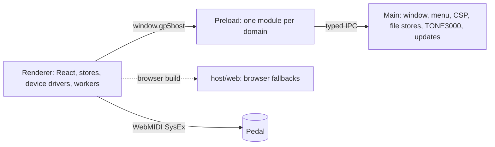

# Architecture

VLTN Tone Studio is an Electron app (Electron 43, React 19, TypeScript, Tailwind v4) that edits Valeton pedals over USB MIDI and plays songs with the pedal following along. The same renderer also runs in a browser (`npm run web`) on WebMIDI. Everything lives in `app/`; the root `package.json` only forwards scripts to it.

## Processes and folders

| Path (under `app/src/`) | Holds |
|---|---|
| `main/` | window, menu, permissions (`midi`, `midiSysex`, audio-only `media`), CSP, the `app://bundle` protocol, Bluetooth. `ipc/` has one module per domain: files, backups, song library (and its backup, Trash, chart and organise logic), TONE3000, updates, display and audience window, band sync, stage power, session log |
| `preload/` | exposes the typed `window.gp5host`, one module per domain; results unwrap to `HostError` |
| `shared/` | the host API types (`host.ts`, `host/*.ts`), the IPC contract, `devices.ts` (`DeviceKey`, `DeviceProfile`) and pure helpers used by more than one process |
| `renderer/src/app/` | the shell, command palette, command bus, toasts, overlays, the navigation rail |
| `renderer/src/state/` | the device store (`device.ts`, contract in `device-types.ts`), `driver/`, navigation, UI bus, MIDI log |
| `renderer/src/screens/` | `rig`, `library`, `setlist`, `tones`, `device`, `song`, plus `capture` (opened from Tones), and two separate windows: `audience` (lyrics, chords or the PDF page for the room) and `follower` (a phone or second computer that follows the leader over the local network) |
| `renderer/src/gp5/`, `gp200/`, `gp150/` | protocol code per pedal family: codec, `.prst`, catalog, session, simulator and byte-exact tests. These folders are the source of truth for the protocols |
| `renderer/src/bluetooth/` | BLE-MIDI framing and the Bluetooth connection |
| `renderer/src/snaptone/`, `userir/` | NAM A1/A2 to SnapTone conversion in a Web Worker; User IR preparation |
| `renderer/src/song/` | stems, analysis, performance playback, band generation, cues, charts; its heavy work runs in workers (`import`, `analysis`, `audio`, `band`, `codec`, `performance`) |
| `renderer/src/host/web/` | browser implementations of the host API |

## The host API

Everything that needs the operating system (files, the song library, backups, TONE3000, updates, Bluetooth, the audience window, band sync) is one interface per domain in `shared/host/`, composed into `HostApi`. A domain has three parts: `main/ipc/<domain>.ts` and `preload/<domain>.ts` for Electron, and `host/web/<domain>.ts` for the browser. Errors use `HostError` codes. Secrets such as tokens stay in main (`safeStorage`) and never reach the renderer.

## Devices

`DeviceKey` (`shared/devices.ts`) is `gp5 | gp50 | gp200 | gp200lt | gp200jr | gp150 | gp180`. Each key has a `DeviceProfile`: name, family, USB IDs, port pattern, slot count and slot labels, blocks, footswitches or CTRLs, SnapTone and User IR tables, tempo range, `.prst` format, whether pedal settings (`globals`) can be read, and whether a simulator exists. Screens read these instead of hard-coding 100 slots or 10 blocks.

Three protocol families sit behind one driver interface (`state/driver/`, `DRIVER_FAMILIES = gp5, gp200, gp150`):

| Family | Pedals | Protocol |
|---|---|---|
| `gp5` | GP-5, GP-50 | nibble SysEx with CRC-8 and an ACK per frame; `.prst` 507 / 552 bytes |
| `gp200` | GP-200, GP-200LT, GP-200JR | TLV records, no checksum, no ACK; `.prst` 1224 bytes |
| `gp150` | GP-150, GP-180 | one protocol and one `.prst` file; Bluetooth LE MIDI next to USB |

Each family has a session (connect, sync, read, edit, save, write with read-back verification), a codec and a simulator (`mock-device.mjs`). The simulators back `?mock=<device key>`, the Device screen's "Simulate a ..." buttons and the tests, so the app runs without a pedal. Real hardware is reached only through WebMIDI.

Rules that follow from this:
- A frame that can reset or brick a pedal is refused by the codec (`DANGEROUS` in `gp150/lib/protocol.mjs`, `dangerOf` in `gp200/lib/protocol.mjs`). Never route around it.
- A write backs up the slot first and is verified by reading it back. The GP-200 family has no ACK, so verification is the only proof.
- Features not yet tried on a real unit are gated per family in `state/device-model.ts` (`EXPERIMENTAL_FEATURES`, `writesLocked`) and switched on by the user, or open on the simulator only.

## Songs and performance

A song is decoded, split into stems by Demucs (WebGPU when available) and analysed (tempo, key, chords, sections, lyrics) in Web Workers. The song library (main process) stores audio as lossless FLAC; every save is staged and flushed before the library index points at it, and deleted songs go to the Trash. Performance plays through Web Audio with gapless joins; MIDI cues are scheduled in a worker on the audio clock and sent over USB or Bluetooth LE. The Setlist screen plays sets and playlists and has stage mode; band sync lets a follower app on the local network follow the leader's transport.

## Data flow of a knob turn

1. The Rig screen calls the device store (`state/device.ts`), which updates the local `PresetState` through the codec seam (`state/preset-codec.ts`).
2. The store asks the active driver to send a live edit; the session queues it (`state/send-queue.ts`) and paces frames for that family.
3. The pedal echoes the change; the session decodes it and the store reconciles. Save writes the slot, verifies it and refreshes the library.

## Conventions

- TypeScript throughout; the protocol libraries are `.mjs` so the Node toolkit tests can import them unchanged.
- Tests sit next to the code as `*.test.ts(x)` (Vitest, jsdom). The protocol libraries have byte-exact `node:test` suites in `gp5/tests`, `gp200/tests` and `gp150/tests`.
- File names that differ only by case are forbidden; macOS and Windows would collide (`app/src/case-collisions.test.ts` checks).
- Vendor data (effect catalogs, factory presets, firmware) is never committed; it is generated at runtime from the user's own installation. Open-source credits are in the `NOTICE.md` of each protocol folder.
- The app is GPL-3.0-only. Take facts and protocol vectors from other projects, not code that is incompatible with that license.
