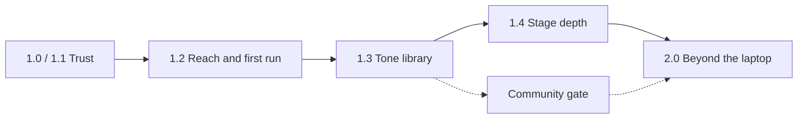

# Product plan

Status: **proposed**, 2026-11-21. Part A is the market and feature analysis, Part B the development plan that follows from it. The short Now / Next / Later view is in the [roadmap](ROADMAP.md); this page gives the reasons and the detail behind it.

How far to trust it: demand evidence comes from public reviews, vendor pages and forum threads found by web search (US-only search; several sources are retailers or affiliate blogs). There is no usage data and no sales data for the app or for Valeton pedals. Treat the findings as sourced facts, reasoned inferences or assumptions that need a check, and re-run the research before committing money to the large items.

# Part A: market and feature analysis

## A1. Who needs this app

| Segment | What they want | Evidence | Fit today |
|---|---|---|---|
| **1. Owners of Valeton GP pedals who want a computer editor** | edit, back up and sort presets on a real screen; no phone required | GP-5 owners say the unit needs a phone or tablet to adjust sounds and wish it could be done on a computer; one says the phone app is unusable on iPhone but fine on iPad; Bluetooth connects intermittently; a Windows 11 driver step is needed (Thomann reviews, Guitar World) | strong: desktop, browser, Linux, backups, diagnostics |
| **2. Tone tinkerers (NAM and IR)** | get captures from TONE3000 onto the pedal without file juggling | TONE3000 reports 700,000+ captures and IRs; Valeton converts NAM to its own SnapTone format, and one review hit a conversion timeout on a non-A1 file | strong, but conversion reliability is the risk |
| **3. Players who practice to songs** | stems, speed and pitch change, chords, loop, count-in | Moises sells exactly this; Valeton Suite 2.1.0 added stem splitting | adequate: all present, no phone app, not unique |
| **4. Gigging players with setlists** | per-song pedal patch change, backing tracks, click, lyrics, charts | BandHelper sends program and control changes per song with several presets per song; MIDI Set List sends program changes by song section; Mixet is a multichannel setlist player with MIDI out and Ableton Link | strong on pedal integration; gaps in routing and tempo sync |
| **5. Rigs with other MIDI pedals** | drive a TimeLine, BOSS or similar from the same cue list | the same setlist apps sell this; the guides document profiles and one real GP-180 plus TimeLine test | adequate: profiles are byte-tested, one real rig |

Inference: segments 1 and 2 are the entry door (people already own the pedal and hit a real problem); segments 3 to 5 are where the app differs from anything the vendor ships, and where retention comes from.

## A2. The competitive set

**Direct** (same job, same hardware): Valeton's own Suite (desktop and mobile). **Adjacent editors** (same job on other hardware, the standard users compare against): Line 6 HX Edit, BOSS Tone Studio, Neural DSP Cortex Control, Fractal Axe-Edit. **Adjacent performance tools**: Moises, BandHelper, OnSong, MIDI Set List, Mixet, MultiTracks Playback, Ableton Live and MainStage. **Substitutes**: the pedal's own screen and footswitches; a DAW with the NAM plugin on a laptop.

| Tool | What it does (from vendor and review pages) | Gap or weakness reported |
|---|---|---|
| **Valeton Suite** (official) | edit patch parameters, patch import and export, IR and NAM import; v2.1.0 adds stem splitting; a Mac and Windows app manages GP-5 captures and IRs | phone dependence for GP-5, flaky Bluetooth, Windows 11 driver step; no setlist or cue features found |
| **Line 6 HX Edit** | free editor, preset librarian and IR manager; manages presets, setlists and IRs | tied to Line 6 hardware |
| **BOSS Tone Studio** | create, edit and organize presets on a computer over USB | tied to BOSS hardware; thin public detail |
| **Neural DSP Cortex Control** | edit, organize, share; cloud presets can be made public and custom IRs travel with a preset | only an all-in-one backup can be saved to a PC; users ask for folder organization; the grid shows only part of downloaded presets |
| **Fractal Axe-Edit** | editor; users ask for sortable browsers for presets, blocks and IRs and for the old library feature back | evidence thin; verify before using |
| **Moises** | 2 to 5+ stems, speed and pitch, chords, metronome, count-in, loop, shared setlists, phone and desktop | price sources conflict; no pedal control; subscription |
| **BandHelper** | per-song MIDI program and control changes, several presets per song, backing tracks, lyrics scrolling, gig scheduling | general purpose, not pedal-aware |
| **OnSong** | charts-first setlists, MIDI editor, program changes with bank select | iOS only; the manual found is from 2019 |
| **MIDI Set List** | program changes by song section | single purpose |
| **Mixet** | multichannel setlist player, MIDI out to other apps, Ableton Link, buses and hardware outputs | advanced sync needs a paid tier (listed at $19.99 a year) |
| **Ableton Live / MainStage** | the flexible way to run tracks, click and instruments live | a full DAW to learn; Ableton is not on iOS |

## A3. Feature comparison

Scale: Strong, Adequate, Weak, Absent, `?` not verified. Our column comes from this repo's guides; competitor columns from the sources above, so treat them as a floor, not a lab test.

| Capability | VLTN Tone Studio | Valeton Suite | HX Edit / Tone Studio / Cortex Control | Setlist apps (BandHelper, OnSong, Mixet) | Moises |
|---|---|---|---|---|---|
| Desktop editor for Valeton pedals | Strong | Adequate | n/a | Absent | Absent |
| Runs on Linux | Strong | `?` | `?` | Absent | Absent |
| Preset library, backups, restore | Strong | Adequate | Strong (HX Edit) | Absent | Absent |
| Share presets with a community | Absent | Weak (export, import) | Strong (Cortex Cloud) | Absent | Absent |
| NAM and IR onto the pedal | Strong | Adequate | Absent | Absent | Absent |
| Tone matching a song | Adequate | `?` | `?` | Absent | Absent |
| Stems, speed, pitch, loop, chords | Adequate | Adequate (stems) | Absent | Weak | Strong |
| Setlist with per-song and per-section patch change | Strong | `?` | Weak (setlists are preset groups) | Strong | Weak |
| MIDI to other pedals, timecode, clock | Adequate | Absent | Absent | Strong | Absent |
| Click and tracks to separate outputs | Adequate (untested on hardware) | Absent | Absent | Strong (Mixet) | Weak |
| Ableton Link tempo sync | Absent | Absent | Absent | Strong (Mixet) | Absent |
| Charts, lyrics, audience display, band sync | Strong | Absent | Absent | Strong (charts), Weak (sync) | Weak |
| Generated drums and bass, song maps | Strong | Absent | Absent | Absent | Absent |
| Phone or tablet app | Weak (follower view in a browser) | Strong | Weak | Strong | Strong |
| Signed installers, auto-update | Weak (unsigned) | Strong | Strong | Strong | Strong |
| Proven on real hardware | Weak (GP-5 full, the rest partial) | Strong | Strong | Strong | n/a |

## A4. Demand signals and trends

| Signal | Evidence | What it means | Response |
|---|---|---|---|
| NAM is going native across hardware | HeadRush added TONE3000 loading on the pedal; Fractal Axe-Fx III and Fender Tone Master Pro announced NAM; native loaders exist; Valeton and Hotone still convert files | the "bring NAM to the pedal" job gets commoditized; for Valeton owners the conversion stays necessary | **Monitor**, and make SnapTone conversion the most reliable part of the app |
| Stems for practice are mainstream | Moises sells it; Valeton Suite 2.1.0 ships it | stems alone are no longer a reason to pick this app | **Parity**; differentiate through the pedal, setlist and band features around the stems |
| Cloud sharing is expected by pedal users | Cortex Cloud with public presets; TONE3000 | supports the Community tab, but moderation and hosting are expensive | **Decision gate** (B6) |
| Setlist and MIDI per song is an established niche | BandHelper, OnSong, MIDI Set List, Mixet | demand exists and paying users exist | **Lead** where pedal awareness adds value |
| Editor frustration is mostly about connection and reach | Valeton reviews: cannot connect, phone only, Windows 11 driver, Bluetooth | reliable connection and clear diagnostics are features | **Invest** in diagnostics and onboarding |
| Budget pedals draw beginners | GP-5 launched at $79 and is framed against the TONEX One | many users are new to multi-effects and to editors | **Invest** in first-run help, not only power features |

Counter-evidence and risks:
- **Valeton can ship these features itself.** Suite already gained stems. An official desktop setlist or cue feature would erase part of the pitch. Mitigation: depth on the stage side, and the Linux, free, open-source position.
- **No size data.** A tool for one vendor's pedals may be small. The plan keeps the multi-pedal MIDI side so the audience is not only Valeton owners.
- **Reverse engineering risk.** Protocols come from analysis, not documentation; a firmware update can break a path. Hence read-back verification and hardware gates.
- **Marketing claims** on vendor pages, and in this repo's README, are not evidence of demand.

## A5. Positioning

For guitarists with a Valeton pedal, and with other MIDI pedals on the same board, who want to edit on a computer and perform with songs, Tone Studio is a free, open-source desktop app that edits and backs up every pedal and runs the song side: stems, setlists, cues, charts and a generated band. Unlike Valeton's own app, it needs no phone, runs on Linux and drives the whole stage rig, not just one patch.

Unclaimed ground: pedal-aware performance (patch change per section, tempo, timecode) tied to a real editor and library. Crowded ground: stems and a plain setlist app. Do not spend effort to out-stem Moises.

## A6. Gaps that matter

| Gap | Seen in | Importance | Plan item |
|---|---|---|---|
| Proof on hardware for most models | every editor in the table is hardware-proven | blocks trust and every "experimental" label | B1 |
| Unsigned installers | all competitors | first-run friction, security warnings | B2 |
| SnapTone conversion reliability (a review of the vendor tool reports a timeout) | TONE3000 flow | core promise of segment 2 | B1 |
| First-run help and connection diagnostics | Valeton reviews | segment 1 entry door | B2 |
| Ableton Link and routing presets | Mixet | stage users who run other apps | B4 |
| Phone or tablet reach | Moises, Suite, setlist apps | many players practice on a phone | B5 |
| Community sharing | Cortex Cloud, TONE3000 | expected, but heavy | B6 |
| Preset conversion across families | none seen | nice to have | B7 |

# Part B: development plan

## B0. Principles

1. **Trust before reach.** A feature that has not worked on a real pedal does not ship as supported.
2. **One audience at a time.** Fix the entry door (segments 1 and 2), then deepen the stage side (4 and 5).
3. **Parity where it is cheap, depth where it is unique.**
4. **Small releases.** Every release has a changelog section, an updated guide and a hardware statement.
5. **Capacity split.** About 70% planned work, 20% tests and tech debt, 10% fixes. Sizes are S (days), M (1 to 3 weeks), L (a month or more) for one developer. There are no dates, because capacity and access to pedals are not known.

## B1. Release 1.0 and 1.1: Trust (Must)

Goal: every shipped claim is true, and users can see what has been proven.

| ID | Work | Scope and acceptance | Size | Depends on |
|---|---|---|---|---|
| T1 | Ship 1.0.0 | merge `release/1.0.0`, tag, bring `develop` to 1.0.0; changelog and README download buttons in step | S | PR #122 merged |
| T2 | Hardware matrix | one table in the docs: model, firmware, what was verified (read, write to a scratch slot, backup, SnapTone, IR, settings), by whom, date; the README support table links to it | S | T1 |
| T3 | Hardware verification script | a step-by-step checklist per family (read-only first, then scratch-slot writes) that produces a log the app can export, so any contributor with a pedal can run it | M | T2 |
| T4 | Run T3 on GP-50, the GP-200 family, GP-150 and GP-180 | each passing feature leaves "experimental"; each failure becomes an issue with the log attached | L, needs units | T3 |
| T5 | SnapTone conversion hardening | a test corpus of NAM A1 and A2 files (sizes, sample rates, lengths); no timeouts on files the pedal accepts; a clear message when a file is too large or unsupported; conversion runs off the UI thread with progress and cancel | M | none |
| T6 | Close the GP-200 follow-ups in the [wiring plan](gp200-wiring-plan.md) | each item has a test or a recorded manual check | M | none |
| T7 | Performance hardware pass | audio outputs, speed and pitch, gapless joins, multitrack import, timecode, with results written into the guide's hardware results | M | audio interface and a pedal |

Exit criteria for 1.1: the matrix exists; GP-5, GP-50 and GP-200 each have a recorded hardware run; no known data-loss bug in a write path; the SnapTone corpus passes.

## B2. Release 1.2: Reach and first run (Should)

Goal: a new GP-5 owner goes from download to a first edit without reading a forum.

| ID | Work | Scope and acceptance | Size |
|---|---|---|---|
| R1 | Signed and notarized builds | macOS notarized, Windows signed; in-app update still verified; install notes in the README lose the quarantine command | M, needs certificates and cost approval |
| R2 | Guided connect | one screen that detects the pedal, names the OS-specific blocker (Windows 11 driver, Linux `/dev/snd/seq` group, browser flags, bootloader mode) and offers the fix; Diagnostics export attaches to a bug report in one click | M |
| R3 | First-run tour | five steps: connect, back up, edit a knob, import a NAM capture, play a song; skippable and re-openable from Help | S |
| R4 | Documentation pass | every guide matches the screens; screenshots refreshed; a "Troubleshooting by symptom" page | M |
| R5 | Release notes by audience | changelog sections grouped as Pedals, Songs, Stage, Fixes | S |

Exit: a person who never used the app completes the first-run path in under 10 minutes on Windows, macOS and Linux (checked with three testers).

## B3. Release 1.3: Tone library and conversion (Should)

Goal: the best way to move NAM captures and IRs onto a Valeton pedal.

| ID | Work | Scope and acceptance | Size |
|---|---|---|---|
| L1 | Batch import | pick many `.nam` or IR files, convert in a queue, place into free slots, show what failed and why | M |
| L2 | Capture library | local tags, favourites, notes and search for SnapTones and IRs per pedal; survives backup and restore | M |
| L3 | Size and version awareness | show which captures a given model can hold, and what conversion will change, before upload | S |
| L4 | Preset diff and merge | compare a slot with a backup or a file, with a readable change list | M |
| L5 | Backup scheduling and retention | automatic backup on connect with a retention rule, restore preview | S |

## B4. Release 1.4: Stage depth (Should / Could)

Goal: lead in pedal-aware performance.

| ID | Work | Scope and acceptance | Size |
|---|---|---|---|
| S1 | Output routing presets | save click, tracks and band to named outputs per rig; one-click recall; tested on a multichannel interface | M |
| S2 | Ableton Link tempo sync | follow or lead a Link session so delays and other apps stay in time (not found in the docs today) | M |
| S3 | Stable app MIDI clock | find the instability seen on the GP-180 rig; a jitter test against a recorded reference; ship as default only if it passes | M |
| S4 | Setlist import and export | open and save a setlist as a file, and import from a plain text or CSV list, so a band can move between tools | S |
| S5 | Rehearsal mode | per-section loop, tempo ramp, count-in on section start, saved per song | S |
| S6 | Pre-gig checklist | one screen that verifies pedals connected, outputs set, songs saved, backups fresh, Send cues on | S |

## B5. Release 2.0: Reach beyond the laptop (Could)

Goal: use it on the phone or tablet people already practise with.

| ID | Work | Scope and acceptance | Size |
|---|---|---|---|
| M1 | Installable web app for follower and practice views | PWA of the follower view with offline charts and lyrics; the existing band sync is the transport | M |
| M2 | Phone editor for the common cases | switch patch, tweak a knob, tuner, tempo over BLE-MIDI where the pedal supports it | L, decision first (hardware and platform limits) |
| M3 | Stage-mode companion | footswitch-friendly large controls on a tablet | M |

Gate: decide M2 only after S1 to S6 land and there is evidence people ask for it (issues, survey).

## B6. Community and sharing (decision gate)

The [Community plan](community-plan.md) is complete and unapproved. Market evidence supports the idea (Cortex Cloud public presets, TONE3000), but the cost is a backend, sign-in, moderation and legal work.

The full analysis, with the GitHub survey and a family-independent design, is in [Custom effects and sharing](CUSTOM-EFFECTS-AND-SHARING.md); its work items C1 to C8 extend this plan.

A cheaper step first, in 1.3: **share without a server.** Export a preset or a "setup" (preset plus notes, guitar, pickups) as one file, and add an import-from-link flow that opens a file hosted anywhere. If people use it, build the server.

Go criteria for the server: answers to the plan's four open questions; a named moderator; a takedown path; and enough hand-exchanged files to show demand (the bar is the maintainer's to set).

## B7. Later options

| Option | Trigger |
|---|---|
| Preset conversion between the GP-5 and GP-200 families | enough users with both families; a model mapping table can be built from the effect catalogs |
| More pedal brands (profiles for other MIDI-capable modelers) | a contributor with the hardware; keep as community profiles in JSON |
| Plugin or scripting API for macros | requests from setlist users |
| Account linking, comments, profiles | only after the server exists |

## B8. Sequence at a glance

Parallel tracks: T5 (conversion) can start now; R1 (signing) waits on the cost decision; the hardware work in B1 depends on access to pedals and is the long pole.

## B9. How we will know it works

Without telemetry, use signals the project already has or can add without tracking users:

| Question | Signal |
|---|---|
| Is anyone using it? | GitHub release download counts per version and platform |
| Is it getting easier? | count of "can't connect" issues per release; first-run test timings (R2, R3) |
| Is it correct? | hardware matrix coverage; data-loss bugs reported (target: zero) |
| Is the stage side wanted? | issues and discussions tagged `stage`; a short opt-in survey linked from Help |
| Is the community idea wanted? | files shared by hand (B6) |

Review these at every release and update this page.

## B10. Open questions

1. Who owns pedals for verification, and for which models and firmware?
2. Is buying signing certificates approved?
3. Is the target audience Valeton owners only, or all MIDI pedal users? The plan assumes Valeton first, with the MIDI side kept general.
4. Should a mobile product (M2) be in scope at all?
5. The four Community questions: domain, upload license, signed-out browsing, bundles.

## Sources

Retrieved 2026-11-21. The web search was US-only and several results are retail or affiliate pages, so treat prices and counts as indicative.

- Valeton reviews and complaints: [Thomann GP-200 reviews](https://www.thomann.co.uk/valeton_gp_200_reviews.htm), [Thomann GP-5 reviews](https://www.thomannmusic.com/valeton_gp_5_reviews.htm?rating=4), [Sweetwater GP-200 firmware article](https://sweetwater.com/sweetcare/articles/valeton-gp-200-firmware-update)
- GP-5 launch price, SnapTone conversion, Windows 11 driver: [Guitar World review](https://www.guitarworld.com/gear/effects-pedals/valeton-gp-5-review), [Sound On Sound review](https://www.soundonsound.com/reviews/valeton-gp-5)
- Valeton Suite: [App Store listing](https://apps.apple.com/app/id6739420888), [Andertons Valeton downloads](https://www.andertons.co.uk/andertons-valeton-downloads)
- Moises: [features](https://moises.ai/features), [latest releases](https://moises.ai/blog/latest/improvements-latest-releases), [App Store](https://apps.apple.com/app/id1515796612)
- HX Edit and BOSS: [HX Edit pilot's guide](https://www.bax-shop.co.uk/downloads/products/9000-0047-1184/hx_edit_pilot's_guide_-_english_.pdf), [Sound On Sound HX review](https://www.soundonsound.com/reviews/line-6-hx-effects)
- Cortex Control and Axe-Edit: [Cortex Control](https://neuraldsp.com/us/cortex-control), [Neural DSP forum: saving presets](https://unity.neuraldsp.com/t/saving-presets-and-setlists-to-pc/19734), [Fractal forum: browsers](https://forum.fractalaudio.com/threads/proper-browsers-for-presets-irs-and-blocks-and-set-lists.162038/)
- NAM and TONE3000: [MusicRadar: TONE3000 plugin](https://www.musicradar.com/guitars/tone3000-has-launched-a-free-open-source-plugin-that-puts-hundreds-of-thousands-of-nam-a2-device-captures-at-your-fingertips), [Guitar World: HeadRush integration](https://www.guitarworld.com/gear/amp-modeler-pedals/headrush-tone3000-nam-integration-update), [Sweetwater: NAM loader pedals](https://www.sweetwater.com/shop/powered-by-nam-a2), [Nail The Mix: pedals that run NAM](https://www.nailthemix.com/the-best-hardware-pedals-that-run-nam-captures)
- Setlist apps: [BandHelper MIDI](https://bandhelper.com/tutorials/sending_MIDI.html), [OnSong manual](https://onsongapp.com/docs/program), [MIDI Set List](https://apps.apple.com/app/midi-set-list/id1658309333), [Mixet](https://apps.apple.com/us/app/mixet/id1468911985), [Best apps for backing tracks live](https://violetrecording.com/best-apps-for-backing-tracks-live/)
